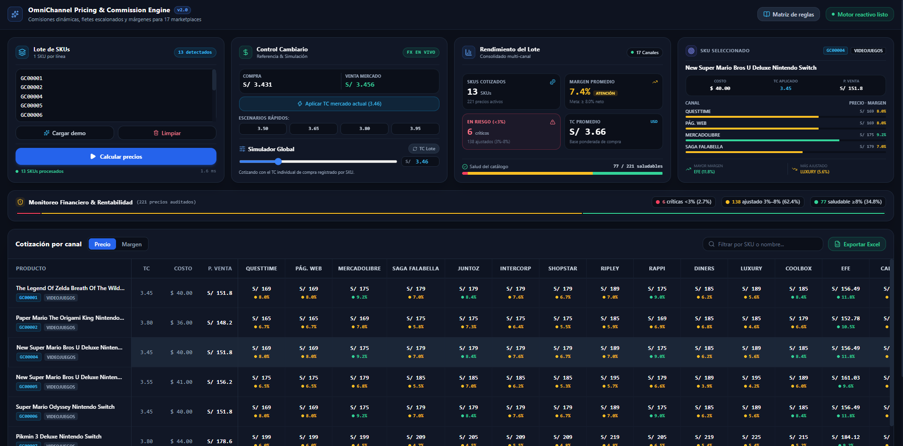
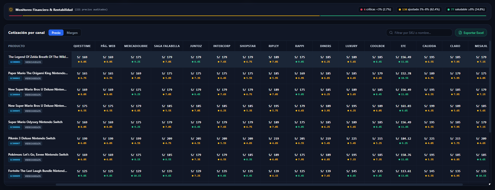
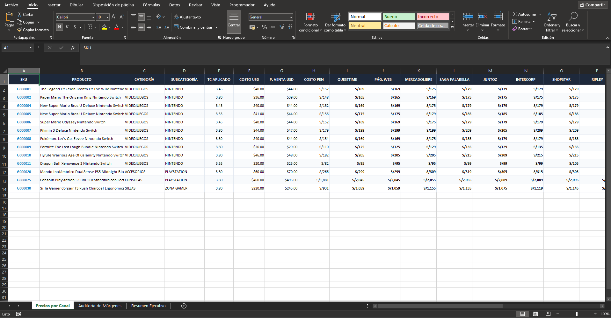
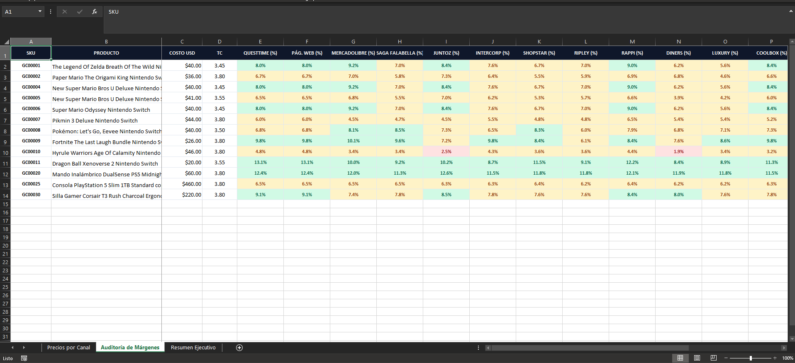

# ⚡ Sistema de Precios y Comisiones Multiplataforma — Game Center

> Sistema web desarrollado para **Game Center** para centralizar, automatizar y optimizar la fijación de precios comerciales y la auditoría de márgenes netos en **17 marketplaces simultáneos**, reemplazando un flujo de trabajo manual basado en hojas de cálculo complejas por un motor de cálculo reactivo en tiempo real.

En **Game Center**, la gestión comercial y publicación de precios en comercio electrónico abarca la venta a través de 17 canales digitales diferentes (Mercado Libre, Falabella, Ripley, Juntoz, Coolbox, Real Plaza, Rappi, Diners, EFE, entre otros).

---

## 📸 Capturas de Pantalla de la Plataforma

Coloca las imágenes capturadas dentro de la carpeta `screenshots/` con los siguientes nombres de archivo:

### 1. Vista General del Dashboard
*Panel unificado de control: lote de SKUs, cotizaciones en vivo, control de TC, KPIs de lote, detalle del producto seleccionado y matriz de precios para 17 marketplaces.*

---

### 2. Vista de la Tabla de Precios
*Integración de Tipo de Cambio en tiempo real y simulador global de estrés cambiario.*

---

### 3. Exportación Ejecutiva a Excel (.xlsx) con ExcelJS
*Generación automática de archivos Excel estructurados con múltiples pestañas, paneles inmovilizados y semáforo condicional de rentabilidad.*

---

## 🔄 Evolución: El "Antes" vs. El "Después"

### 🔴 El Antes: Gestión Manual en Hojas de Cálculo
La fijación de precios se administraba mediante un archivo Excel sobredimensionado y de alta complejidad operativa:
* **Múltiples pestañas fragmentadas:** Existía una hoja de cálculo separada para cada categoría de producto (*Videojuegos*, *Consolas*, *Accesorios*, *Sillas*, etc.), donde en cada una se repetían manualmente las columnas de las 17 plataformas.
* **Fórmulas kilométricas propensas a errores:** Cada celda contenía fórmulas extensas y anidadas (condicionales `SI`, búsquedas verticales y deducciones de comisión/flete). Un simple cambio accidental en una celda corrompía el cálculo de toda la línea de producto.
* **Incapacidad de simulación cambiaria:** Ante la volatilidad del dólar, resultaba inviable proyectar el impacto de un nuevo Tipo de Cambio en miles de precios de forma inmediata; requería editar hojas enteras celda por celda.
* **Ceguera de margen neto:** Era muy difícil identificar visualmente qué canales caían en margen de ganancia crítico o pérdida tras comisiones y fletes.

### 🟢 El Después: Sistema Centralizado Reactivo
Con el desarrollo de esta plataforma web:
* **Vista única consolidada:** Se procesa todo el catálogo en una sola pantalla unificada, sin importar la categoría de los productos ingresados.
* **Cálculo instantáneo por lote:** El motor procesa cientos de cotizaciones cruzadas contra las 17 plataformas en **menos de 1 milisegundo**, resolviendo automáticamente fletes, comisiones y reglas de redondeo.
* **Control y simulación de Tipo de Cambio en vivo:** Integración con Tipo de Cambio de mercado y un simulador interactivo para evaluar escenarios de fluctuación cambiaria al instante.
* **Semáforo y auditoría financiera:** Monitoreo visual de salud de margen neto en tiempo real (crítico `<3%`, ajustado `3%–8%`, saludable `≥8%`) con inspección detallada celda por celda.
* **Exportación profesional en Excel (`.xlsx`):** Generación automática de libros Excel formateados con múltiples pestañas, paneles inmovilizados, formatos de moneda y colores condicionales vía `exceljs`.

---

## 📊 Matriz Comparativa de Impacto Operativo

| Dimensión | Enfoque Anterior (Excel Multitabla) | Solución Implementada (Sistema Web) |
| :--- | :--- | :--- |
| **Organización de Datos** | Múltiples hojas separadas por categoría con fórmulas repetidas. | Vista unificada que clasifica y procesa cualquier categoría dinámicamente. |
| **Tiempo de Cálculo** | Varias horas al actualizar o recalcular libros pesados. | **Sub-milisegundo (< 1 ms)** mediante motor funcional reactivo. |
| **Sensibilidad Cambiaria (TC)** | Actualización manual celda por celda o cambio de constantes rígidas. | Simulación en tiempo real mediante slider y escenarios preconfigurados. |
| **Margen y Rentabilidad** | Cálculo oculto dentro de fórmulas; riesgo inadvertido de venta a pérdida. | Semáforo visual tricolor de márgenes y auditoría de cascada financiera en 1 clic. |
| **Reglas Comerciales** | Dependencia de macros complejas o redondeo manual humano. | Algoritmo estricto de terminación retail aplicado de forma automática. |
| **Riesgo Operativo** | Alto: rotura accidental de fórmulas o desincronización de versiones. | Nulo: lógica de negocio centralizada, tipada en TypeScript y desacoplada de la UI. |

---

## 🛠️ Stack Tecnológico

| Tecnología | Rol en el Proyecto |
| :--- | :--- |
| **React 18** | Arquitectura de componentes modulares y renderizado reactivo de alta velocidad. |
| **TypeScript 5.6** | Tipado estático estricto para operaciones financieras y reglas de comisiones. |
| **Tailwind CSS 3.4** | Interfaz oscura de grado enterprise con diseño de alta densidad de información. |
| **ExcelJS** | Generación cliente de libros `.xlsx` estilizados con formato de celdas y semáforo condicional. |
| **Lucide Icons** | Iconografía limpia y minimalista para dashboards ejecutivos. |
| **Vite 6.0** | Entorno de desarrollo ultrarrápido y empaquetado optimizado para producción. |

---

*Proyecto desarrollado como solución de ingeniería de software y automatización comercial para **Game Center**.*
